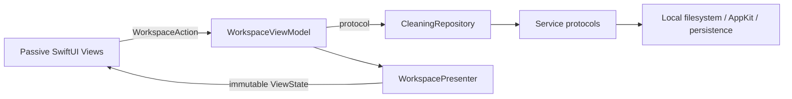

# Architecture and invariants

## Layers and dependency direction (0.2)

- **Core / Contracts:** domain types and capability protocols; Foundation/CryptoKit only.
- **Core / Repositories:** `LocalCleaningRepository` coordinates scan, cleanup, settings, history and running-app checks. It depends on protocols, never concrete OS implementations.
- **App / Services:** `LocalScanService`, `LocalCleanupService`, `LocalDiskInfoService`, `JSONHistoryStore`, `UserDefaultsSettingsStore`, `MacDesktopService` and `LocalProjectValidator` implement the ports. File work runs off the main actor; the history store is an actor; desktop UI stays on the main actor.
- **Presentation:** `WorkspaceViewModel` owns the operation state, selection, filters, confirmation and cancellation. It only receives a `CleaningRepository`; it imports Foundation/Combine, never SwiftUI or AppKit. `WorkspacePresenter` performs formatting, aggregation, path abbreviation and eligibility projection into `WorkspaceViewState`.
- **App / Views:** passive render functions with a state value and an action closure. No repository, ViewModel, filesystem or singleton access. Local `@State` is limited to ephemeral appearance such as expanded rows and hover state.
- **App / DesignSystem:** shared colors, cards, buttons, number transitions, storage ring and scan activity indicator. Animation belongs here and in views, never in business logic.
- **App / Composition:** `AppContainer` is the composition root; `SafeCleanerApp` owns the ViewModel lifetime and injects snapshots and actions. Preview constructs an inert repository, not live services.

SwiftPM compiles Core and Presentation as separate library modules and tests them independently. The generated native Xcode app target compiles the same source folders together for packaging. Its navigator mirrors the source hierarchy.

## State and concurrency

The ViewModel publishes a read-only snapshot and accepts typed intents through `send`. Views cannot directly change selection or start an OS operation. Busy guards and preview guards are checked in the ViewModel, even if a disabled UI action were called programmatically. Opening the confirmation resets acknowledgement; dismissal or selection changes invalidate it. Cleanup requires the current acknowledged confirmation.

Scanning has an operation ID. Late progress callbacks cannot update another operation. Cancellation propagates from the ViewModel task through the service to the detached scanner worker. Filtering never silently deselects hidden items; the confirmation lists the full selection.

The repository writes the existing history before any move to establish that storage works. Unreadable history blocks cleanup instead of being overwritten. A write failure after a move stops the batch and retains the result in memory. This is not yet a crash-safe transaction journal; a full journal and recovery workflow remain roadmap work.

## Motion system

Navigation uses a shared sidebar selection indicator and a short opacity/offset transition. Number changes and storage/category rings animate to the next measured value. Rows expand with a damped spring; buttons have restrained press feedback and hover surfaces. Scan activity is time-driven only while mounted. Every custom motion reads `accessibilityReduceMotion`; the scan indicator becomes static and positional/numeric animations are disabled when reduced motion is requested. No animation fabricates progress or changes timing of cleanup operations.

## Dependency checks

Run `python3 scripts/check-boundaries.py` alongside `swift test`. The checker rejects OS/storage calls and ViewModel access in passive views and rejects UI/OS imports in the presentation module. Add behavior tests with fake repositories/services, not UI-driven cleanup of actual caches.

## Scan → plan → execute

1. A scan receives immutable configuration (home, explicit project roots, exclusions).
2. Known rules nominate locations. Source code, cloud roots and user documents have no cleanup rules.
3. Each tree is measured with a deterministic metadata snapshot. Unsupported entries reject the entire candidate.
4. Candidates contain the snapshot, approved root, consequences and a cleanup capability flag.
5. UI selection begins empty. Search/filtering does not implicitly change it.
6. Confirmation lists exact paths and requires the user to close apps/stop builds.
7. Known running bundle owners block the batch; unknown command-line processes are an acknowledged limitation.
8. The executor refuses scan-only candidates, revalidates containment and tree metadata, then uses `FileManager.trashItem`.
9. Each result is persisted. Failure never calls `removeItem` on the selected location.

## Filesystem policies

- Component-aware containment. A root itself is not a valid child.
- Inspect each ancestor without treating a symlink target as an authorization grant.
- Refuse symlink descendants, special files, packages, hard-linked regular files and cross-device traversal inside candidates.
- Propagate directory-read errors; an unreadable tree cannot silently become a smaller “safe” candidate.
- Record paths, inodes, sizes, types and modification timestamps in a SHA-256 metadata digest. This is **not** a content hash.
- Project roots are explicit local home descendants. Dotfolders/dependencies are pruned except supported generated-folder candidates.
- Default cloud exclusions are iCloud Drive and `Library/CloudStorage`; arbitrary third-party synced folders outside those paths require user exclusions.
- Cleanup selection comes only from the current in-memory scan; history cannot be replayed as a delete request.

## Limits / threat model

This release is intended for a user reviewing ordinary caches with applications closed. It is not safe against an adversarial process modifying a selected tree between validation and the move. A future executor should use stronger filesystem coordination and a transaction journal. Do not elevate privileges to work around this.

Snapshotting currently enumerates the whole selected tree and sorts children for stable ordering. Very broad trees may be slow or use significant memory per directory. Cancellation is checked between entries. Project discovery has a depth/directory cap; cache measurement has no arbitrary silent size cap.

APFS clones and snapshots mean allocated-byte sums cannot predict unique physical reclamation. UI keeps candidate estimates separate from current filesystem free bytes. Trash moves are not reported as physical savings.

## Extending rules

Before adding a cleanable location:

1. Verify current official tool documentation, including custom configuration paths.
2. Identify what is disposable and what is source, configuration, credentials, shared data or active state.
3. Add a narrow rule with specific consequences and an owner where possible.
4. Add fixtures for a positive match, a misleading name, a changed item, nested links and an excluded path.
5. Prefer scan-only until the lifecycle and rebuild behavior have been tested.

Never add a broad `find … -name build -delete`, blanket library cleanup, or shell command assembled from a user-provided path.

## Tool-managed removals (0.5)

Some stores are owned by a tool and must be removed by it, never by a Trash move: simulator
runtimes are root-owned disk images and simulator devices are registered with CoreSimulator.
`Candidate.removal` marks such an item; the row, the selection caption, the confirmation sheet
and the Activity list all say it is permanent. `ToolCommand` in Core holds the only commands
that can run (a catalogue with a private initializer); the per-item deletes take one argument,
a UUID that simctl itself reported, re-validated before it becomes an argument.
`ToolRunner` in Services is the one place a process is launched: validated executable, minimal
environment, no stdin, hard timeout, terminated on cancellation. The scan pass
(`SimulatorScan`) runs two read-only list commands and `SimulatorRules` decides what may be
offered; the removal (`SimulatorRemover`) re-lists immediately before each delete and leaves
an item in place if it no longer qualifies, mirroring the snapshot check on the Trash path.
`LocalCleaningRepository.clean` dispatches by `removal`; `CleanupEngine` refuses tool-managed
items outright. Histories record `method: tool`; older files decode with the field absent.

## Android SDK stores (0.5.1)

`AndroidSDK` in Core is version-aware listing with no process: it reads what projects name
(`ndkVersion` in Gradle files near each detected project root, `sdk.dir` in
`local.properties`) and what virtual devices use (`image.sysdir.1` in each AVD's
`config.ini`), then offers NDK versions nobody names except the newest, system images no
device uses, and the `snapshots` folder of every stopped AVD. Each finding becomes an
ordinary Trash candidate through the scanner's `add`, so exclusions, the snapshot digest,
the running-owner check (Android Studio) and the change re-check all apply unchanged.

## Xcode per-version stores (0.5.2)

`XcodeStores` in Core lists four stores under `~/Library/Developer/Xcode` with no process:
`<platform> DeviceSupport/<entry>` for every OS version below the newest per platform (the
version is the first dotted number in the folder name, so a model identifier never counts and
two devices on the same version are both kept); each index under `DocumentationCache`; each
device folder under `DeviceLogs` or `iOS Device Logs` whose newest file is 30 days old; and
each `.xcarchive` 180 days old by the creation date in its `Info.plist`, falling back to the
date folder's name. Findings become ordinary Trash candidates through the scanner's `add` with
Xcode as owner, so exclusions, the snapshot digest, the running-owner check and the change
re-check apply unchanged. Archives are not regenerable, so the reason names the app, version,
build and bundle identifier and the consequence says what symbolication is lost.

## Safety pack (0.5.3)

`OpenFileChecking` in Core is a port that returns an `OpenFileIndex`: a point-in-time table of
what this user's processes hold (open file descriptors, working directories, executables) as
`ProcessUse` rows. `LibprocOpenFileService` in Services fills it through libproc, read-only, on
a detached task. `LocalCleaningRepository.clean` reads the table once per batch (refreshed when
older than ten seconds) and, for each Trash item, leaves it in place with `failure: .inUse` and
the process names when anything in the table sits inside it; the result sheet shows those as
one row. `FileSafety.sensitiveLocations` is the never-offer list, applied in the scanner's `add`
(an issue, not a candidate) and again in `CleanupEngine.perform` before the item is read. The
engine also verifies after `trashItem` that the source is gone, so a move that reported success
while leaving the item in place is a failure. The scanner marks items the current user cannot
write with `Candidate.blocker` and `canTrash = false`; the presenter shows them as *Not movable*.
`WorkspaceSettings.awaitingFullDiskAccess` records that the user was sent to the Full Disk
Access pane; the view model reports the outcome at the next launch and the repository clears the
flag. `StructuralTests` read the `Sources` tree and pin the single Trash call, the absence of any
delete, the single process launcher, the single network client and the single libproc reader.

## Gradle and Kotlin/Native stores (0.5.4)

`GradleStores` in Core is version-aware listing with no process, like `AndroidSDK`. `references`
walks each detected project root four levels deep (skipping `build`, `node_modules`, `.gradle`,
`.git` and hidden folders) and collects Gradle versions from `distributionUrl` in every
`gradle-wrapper.properties` (the version in the zip's file name, whatever the host) and Kotlin
versions from `[versions]` keys starting with `kotlin` in `*.versions.toml`, inline plugin versions
and `org.jetbrains.kotlin:*:<version>` coordinates, `kotlin("…") version "…"`,
`id("org.jetbrains.kotlin…") version "…"` and `kotlin-gradle-plugin:` in build and settings files,
and `kotlin.version`-style keys in `gradle.properties`. A version taken from a variable (other than
a catalog accessor) or a wrapper URL whose file name carries no version is flagged and stated in
every reason. `findings` treats a folder as a Gradle version only when its name is a dotted number
(`8.14.3`, `9.0.0-rc-1`), so `modules-2`, `jars-9` or `journal-1` can never match; keeps every
referenced version exactly (no prefix matching, since 8.14 and 8.14.3 are different
distributions) and the newest installed across caches, distributions and daemons; and offers
`.tmp` whole. Kotlin/Native compilers are recognised by the
`kotlin-native-prebuilt-macos-<arch>-<version>` name, kept when a reference matches exactly or as a
`major.minor` prefix, and the newest per architecture is kept. `dependencies/<entry>` is offered
only when every kept compiler has a readable `konan/konan.properties` and none of them names the
entry as a whole token (Kotlin/Native re-downloads an entry whose folder is missing regardless of
its `.extracted` marker); otherwise an issue says the shared dependencies were kept. A final filter
drops any finding that is a store root itself, lies outside it, or touches
`GradleStores.neverOffered` or a `jars-*` folder. Each finding becomes an ordinary Trash candidate
through the scanner's `add` with Android Studio as owner, so exclusions, the never-offer list, the
writability guard, the snapshot digest, the open-file check and the change re-check apply
unchanged. `GRADLE_USER_HOME` and `KONAN_DATA_DIR` are not read; only the default homes are scanned.

## Optional Claude review (0.4)

`AIReviewPacket` in Core groups candidates using a fixed label catalogue. The encoded payload
contains group IDs, types, counts, allocated MB, scan-only flags and counts of omitted groups and
scan issues. Local paths, titles, digests, owners and errors are not encoded. A separate local
fingerprint includes snapshot digests so changed scans invalidate advice reuse.

The ViewModel reaches Claude only through `CleaningRepository`. The repository reads the API key
through `APIKeyStoring`; `KeychainAPIKeyStore` and the concrete `ClaudeService` are assembled in
`AppContainer`. The service uses an ephemeral HTTPS session to the fixed Anthropic endpoint,
refuses redirects, caps response bytes and has no tool, filesystem or cleanup capability.
`ClaudeMessages` builds bounded requests and validates JSON responses, known/unique group IDs,
stop reasons and scan-only restrictions. The transport returns status and body together; a
non-200 body is mapped by `ClaudeMessages.failure` to a `ClaudeFailure` whose kind (authentication,
billing, model, rate limit, service, network) lets the ViewModel update the key status, and whose
message carries Anthropic's error type and message in sanitized, bounded form. Nothing is logged.
`verify` is one GET against the Models endpoint with the key alone; the ViewModel exposes it as
“Test key” and keeps the result as session-only state.

Analysis is an explicit busy operation. No startup/scan/key-save requests, automatic retries,
model escalation or auto-selection exist. New scans, candidate removal and model changes clear
visible advice; a single most recent successful analysis is cached in memory by model and snapshot.
Key replacement/removal clears the cache. Key input is transient, cleared after saving or leaving
Settings, and never loaded back into the view state. Preview never accesses Keychain or the API.
