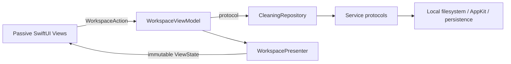

# Architecture and invariants

## Layers and dependency direction (0.2)

- **Core / Contracts:** domain types and capability protocols; Foundation/CryptoKit only.
- **Core / Repositories:** `LocalCleaningRepository` coordinates scan, cleanup, settings, history and running-app checks. It depends on protocols, never concrete OS implementations.
- **App / Services:** `LocalScanService`, `LocalCleanupService`, `LocalDiskInfoService`, `JSONHistoryStore`, `UserDefaultsSettingsStore`, `MacDesktopService` and `LocalProjectValidator` implement the ports. File work runs off the main actor; the history store is an actor; desktop UI stays on the main actor.
- **Presentation:** `WorkspaceViewModel` owns the operation state, selection, filters, confirmation and cancellation. It only receives a `CleaningRepository`; it imports Foundation/Combine, never SwiftUI or AppKit. `WorkspacePresenter` performs formatting, aggregation, path abbreviation and eligibility projection into `WorkspaceViewState`.
- **App / Views:** passive render functions with a state value and an action closure. No repository, ViewModel, filesystem or singleton access. Local `@State` is limited to ephemeral appearance such as expanded rows and hover state.
- **App / DesignSystem:** shared colors, cards, buttons, number transitions, storage ring and scan activity indicator. Animation belongs here and in views, never in business logic.
- **App / Composition:** `AppContainer` is the composition root; `ViggoCleanApp` owns the ViewModel lifetime and injects snapshots and actions. Preview constructs an inert repository, not live services.

SwiftPM compiles Core and Presentation as separate library modules and tests them independently. The generated native Xcode app target compiles the same source folders together for packaging. Its navigator mirrors the source hierarchy.

## State and concurrency

The ViewModel publishes a read-only snapshot and accepts typed intents through `send`. Views cannot directly change selection or start an OS operation. Busy guards and preview guards are checked in the ViewModel, even if a disabled UI action were called programmatically. Opening the confirmation resets acknowledgement; dismissal or selection changes invalidate it. Cleanup requires the current acknowledged confirmation.

Scanning has an operation ID. Late progress callbacks cannot update another operation. Cancellation propagates from the ViewModel task through the service to the detached scanner worker. Filtering never silently deselects hidden items; the confirmation lists the full selection.

The repository writes the existing history before any move to establish that storage works. Unreadable history blocks cleanup instead of being overwritten. A write failure after a move stops the batch and retains the result in memory. This is not yet a crash-safe transaction journal; a full journal and recovery workflow remain roadmap work.

## Motion system

Navigation uses a shared sidebar selection indicator and a short opacity/offset transition. Number changes and storage/category rings animate to the next measured value. Rows expand with a damped spring; buttons have restrained press feedback and hover surfaces. Scan activity is time-driven only while mounted. Every custom motion reads `accessibilityReduceMotion`; the scan indicator becomes static and positional/numeric animations are disabled when reduced motion is requested. No animation fabricates progress or changes timing of cleanup operations.

## Dependency checks

Run `python3 scripts/check-boundaries.py` alongside `swift test`. The checker rejects OS/storage calls and ViewModel access in passive views and rejects UI/OS imports in the presentation module. Add behavior tests with fake repositories/services, not UI-driven cleanup of actual caches.

## Scan → plan → execute

1. A scan receives immutable configuration (home, explicit project roots, exclusions).
2. Known rules nominate locations. Source code, cloud roots and user documents have no cleanup rules.
3. Each tree is measured with a deterministic metadata snapshot. Unsupported entries reject the entire candidate.
4. Candidates contain the snapshot, approved root, consequences and a cleanup capability flag.
5. UI selection begins empty. Search/filtering does not implicitly change it.
6. Confirmation lists exact paths and requires the user to close apps/stop builds.
7. Known running bundle owners block the batch; unknown command-line processes are an acknowledged limitation.
8. The executor refuses scan-only candidates, revalidates containment and tree metadata, then uses `FileManager.trashItem`.
9. Each result is persisted. Failure never calls `removeItem` on the selected location.

## Filesystem policies

- Component-aware containment. A root itself is not a valid child.
- Inspect each ancestor without treating a symlink target as an authorization grant.
- Refuse symlink descendants, special files, packages, hard-linked regular files and cross-device traversal inside candidates.
- Propagate directory-read errors; an unreadable tree cannot silently become a smaller “safe” candidate.
- Record paths, inodes, sizes, types and modification timestamps in a SHA-256 metadata digest. This is **not** a content hash.
- Project roots are explicit local home descendants. Dotfolders/dependencies are pruned except supported generated-folder candidates.
- Default cloud exclusions are iCloud Drive and `Library/CloudStorage`; arbitrary third-party synced folders outside those paths require user exclusions.
- Cleanup selection comes only from the current in-memory scan; history cannot be replayed as a delete request.

## Limits / threat model

This release is intended for a user reviewing ordinary caches with applications closed. It is not safe against an adversarial process modifying a selected tree between validation and the move. A future executor should use stronger filesystem coordination and a transaction journal. Do not elevate privileges to work around this.

Snapshotting currently enumerates the whole selected tree and sorts children for stable ordering. Very broad trees may be slow or use significant memory per directory. Cancellation is checked between entries. Project discovery has a depth/directory cap; cache measurement has no arbitrary silent size cap.

APFS clones and snapshots mean allocated-byte sums cannot predict unique physical reclamation. UI keeps candidate estimates separate from current filesystem free bytes. Trash moves are not reported as physical savings.

## Extending rules

Before adding a cleanable location:

1. Verify current official tool documentation, including custom configuration paths.
2. Identify what is disposable and what is source, configuration, credentials, shared data or active state.
3. Add a narrow rule with specific consequences and an owner where possible.
4. Add fixtures for a positive match, a misleading name, a changed item, nested links and an excluded path.
5. Prefer scan-only until the lifecycle and rebuild behavior have been tested.

Never add a broad `find … -name build -delete`, blanket library cleanup, or shell command assembled from a user-provided path.
